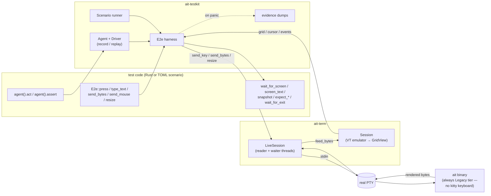
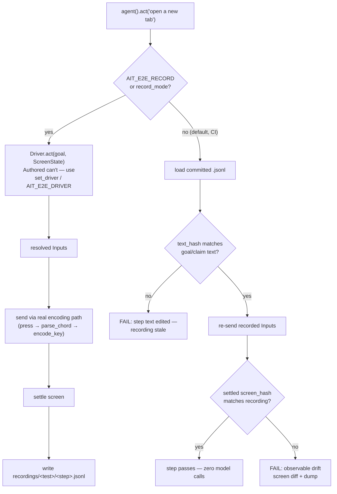

# Testing toolkit (`ait-testkit`)

AIT's agentic end-to-end testing toolkit (Spec E01, GitHub issue #19).
A test-only crate — dev-dependency only, no product crate may depend on
it — that spawns the **real `ait` binary in a real PTY** and asserts on
the **rendered screen**: the same grid a user sees. The engine is
`ait-term`'s `LiveSession`; `ait-testkit` adds a convenience layer
(`E2e`), an agent-step layer with record/replay, and a declarative
TOML-scenario runner.

The gap it fills: `cargo test --workspace` proves correctness, not
feature behavior. "Press `Alt+T`, a tab opens, the bar updates" is the
acceptance layer a reviewer would otherwise exercise by hand.

## Architecture



Input goes in as named chords (`"Alt+T"`), literal text, raw bytes
(the escape hatch), SGR mouse events or resizes. Output comes back as
the grid's text rows, cursor, `SessionEvent`s (clipboard writes, exit)
and a bounded raw-PTY tail (`LiveSession::output_tail`, 64 KiB).

Because the harness's `Session` never answers the kitty-keyboard query,
the spawned `ait` always resolves `CapabilityTier::Legacy` — e2e covers
the `Alt+*`/`Ctrl+PageUp/Down`/`Shift+*` bindings, never the enhanced
`Ctrl+Shift+*` aliases (ADR-0005; that coverage stays at the keymap
seam).

## Where things live

```
crates/ait-testkit/            the harness library
  src/harness.rs               E2e, SpawnConfig — spawn + verbs + waits
  src/chord.rs                 "Alt+T" → KeyEvent parser
  src/mouse.rs                 SGR 1006 mouse encoder
  src/driver.rs                Driver trait, Input, Verdict, Authored
  src/agent.rs                 agent().act/assert + settle/drift logic
  src/recording.rs             *.jsonl format + path convention
  src/screen.rs                ScreenState (serde) + FNV hashes
  src/command.rs               Command driver (AIT_E2E_DRIVER subprocess)
  src/scenario.rs              TOML scenario format + runner
  src/evidence.rs              failure dumps, dump_root, panic_text
  tests/                       self-tests on /bin/sh — no ait needed

crates/ait/tests/
  e2e.rs                       code-first e2e tests + insta snapshot
  scenarios.rs                 runner: every tests/scenarios/*.toml
  scenarios/*.toml             the committed acceptance set (15 files)
  recordings/<test>/*.jsonl    frozen agent steps (authored assets)
  snapshots/*.snap             insta screen snapshots

docs/e2e-driver-protocol.md    the Command driver's wire protocol
docs/examples/e2e-driver-stub.sh
```

## Code-first tests

```rust
use ait_testkit::{ait_bin, E2e, SpawnConfig, Size};

#[test]
fn alt_t_opens_a_second_tab() {
    let mut app = E2e::spawn(SpawnConfig::new(ait_bin!(), &[], Size::new(80, 24)))
        .expect("spawn ait");

    app.wait_for_screen("status line", |a| a.screen_text().contains("running"));
    app.press("Alt+T");
    app.wait_for_screen("second tab", |a| a.line(0).contains("2:sh"));

    app.press("Alt+Q");
    assert!(app.wait_for_exit().success());
}
```

- `ait_bin!()` resolves the binary: `$AIT_E2E_BIN` →
  `CARGO_BIN_EXE_ait` (expanded in the *consuming* crate — the macro
  exists because `env!` inside `ait-testkit` would see nothing).
- Spawned programs get a pinned environment: `SHELL=/bin/sh`,
  `PS1="$ "`, a fresh temp cwd, `TERM=xterm-256color` — screens
  reproduce across machines and CI. `SpawnConfig.env` is the escape
  hatch (applied after the pins).
- Every wait is bounded (~15 s); timeouts and failed asserts panic with
  the screen in the message. **No fixed sleeps.**
- `app.snapshot()` returns cwd-redacted screen text for
  `insta::assert_snapshot!` — screen regressions review as plain-text
  diffs.

## Scenarios

Acceptance criteria as data — an agent can write one straight from
ticket text. Every `crates/ait/tests/scenarios/*.toml` file is one
scenario run on its own thread named after the file stem.

```toml
feature = "tabs"          # required tag (filtered-run metadata)
size = [80, 24]

[[steps]]
wait_text = "· sh · — · running"

[[steps]]
keys = ["Alt+T"]

[[steps]]
expect_text = " 1:sh  2:sh"
```

Verbs (one per `[[steps]]`): `keys`, `text`, `bytes` (hex), `mouse`
(`{event, col, row, button?}`, 0-based cells), `resize`, `wait_text`,
`expect_text` / `expect_regex` / `expect_cursor` / `expect_exit` /
`expect_clipboard`, plus `act` / `assert` (agent steps). Top level:
`feature`, `size`, `args`, `env`. Full table:
`crates/ait-testkit/src/scenario.rs` module docs.

`wait_*` gates progress; `expect_*` asserts — both are bounded waits.
Malformed files name file + step; failing steps name scenario + step —
never a bare panic. A scenario with zero agent steps is pure
deterministic replay.

## Agent steps: record / replay

`act`/`assert` steps go through a `Driver`. At **record** time a
driver resolves them against the screen; the resolution is committed
as `tests/recordings/<test>/<step>.jsonl` — *semantic* inputs
(`{"key":"Alt+T"}`, `{"text":"…"}`, `{"bytes":"<hex>"}`), readable and
writable by humans and agents. At **replay** time (the default,
including CI) no model is involved at all.



The guard is `text_hash` + `screen_hash` — editing a step's goal
invalidates its recording; rebuilding the binary does not (`program`
is provenance only — **no binary hash**). Drift is a first-class
failure with the screen diff, not a soft warning.

## Drivers

| backing | selected by | resolves | used where |
|---|---|---|---|
| `Authored` | default | nothing — replay only; panics with authoring guidance if a recording is missing | CI, all normal runs |
| `Command` | `AIT_E2E_DRIVER=<cmd>` | each step via a subprocess: versioned JSON in on stdin, JSON out on stdout | local re-recording |
| `ait-llm` | — | deferred until the crate exists; the trait is shaped for it | future |

`Command` wire protocol, failure modes, and a working stub wrapper:
[docs/e2e-driver-protocol.md](e2e-driver-protocol.md). Secrets reach
the subprocess through the inherited environment only — never in tests,
recordings, or the repo.

## Failure evidence

Any panic while an `E2e` is alive — harness wait, harness assert, or
test-side `assert!` — triggers `Drop` to dump:

```
target/e2e-failures/<test>/
  screen.txt      final screen text
  pty-tail.bin    last ≤64 KiB of raw PTY output fed into the grid
  actions.log     ordered action log: inputs sent + screen-state hash per step
```

`<test>` is the sanitized thread name (the test's own name under
`cargo test`, the scenario's file stem under the scenario runner);
`AIT_E2E_DUMP_DIR` overrides the root. CI's `e2e` job uploads
`target/e2e-failures/` as an artifact on failure.

## Environment variables

| var | effect |
|---|---|
| `AIT_E2E_BIN` | override the spawned program path (else `CARGO_BIN_EXE_ait`) |
| `AIT_E2E_RECORD` | record mode: re-resolve agent steps via the active driver, rewrite `*.jsonl` |
| `AIT_E2E_DRIVER` | `Command` backing — subprocess command resolving steps (record mode only) |
| `AIT_E2E_RECORDINGS` | override the recordings root (else `<crate>/tests/recordings`) |
| `AIT_E2E_DUMP_DIR` | override the failure-dump root (else `<workspace>/target/e2e-failures`) |
| `AIT_E2E_HEADED` | headed mode: mirror raw PTY output to the controlling terminal while tests run |
| `AIT_E2E_SLOWMO` | watch pacing in ms: fixed delay after each input verb (overrides `SpawnConfig::slowmo_ms`) |

## Watching tests run (headed mode)

Tests are headless by default — the spawned program renders into the
harness's in-memory grid, invisible to you. `AIT_E2E_HEADED=1` (or
`SpawnConfig.headed` / a scenario's `headed = true`) attaches
`LiveSession::set_output_mirror`: raw PTY bytes are mirrored to
`/dev/tty` (falling back to stderr) *as the reader reads them*, so the
program's escape sequences paint your terminal live — the same TUI a
user sees, alt-screen and all.

```bash
cargo build -p ait
# watch at human speed: 400ms after every input
AIT_E2E_HEADED=1 AIT_E2E_SLOWMO=400 cargo test -p ait --test scenarios -- --test-threads=1
```

`--test-threads=1` matters: parallel tests would interleave their
mirrors on the one terminal. `AIT_E2E_SLOWMO=<ms>` (or a scenario's
`slowmo = <ms>`) paces inputs so the run stays readable — it delays
input verbs only, never a wait, so it can't change outcomes.

Mirroring is a tap, not part of the pipeline — a failing mirror write
detaches silently and changes nothing about drains, backpressure or
events. When an `E2e` that ran headed drops, the harness restores the
host terminal's modes (alt-screen, mouse reporting, bracketed paste,
kitty flags) — a child that dies without its own cleanup would
otherwise leave the terminal echoing escape codes on every scroll.
If a terminal ever *does* get stuck that way, `reset` fixes it.

To poke at a session by hand instead of watching a test,
`cargo run -p ait-testkit --example drive` drives the grid
interactively from your keyboard.

## CI

`.github/workflows/ci.yml` has two jobs: `check` (the three AGENTS.md
gates verbatim — `cargo test --workspace` already covers the e2e
suite) and `e2e` (build `ait`, run `-p ait -p ait-testkit`, upload
`target/e2e-failures/` as an artifact on failure). Everything runs
without a TTY or network — the PTY is ours (REQUIREMENTS.md §6).

## Not covered (by design)

- Enhanced-tier `Ctrl+Shift+*` bindings and the hung-probe path —
  untestable here by construction (Legacy tier only).
- Unit tests of emulator internals — stay byte-fed at the `Session`
  seam; the toolkit is the layer above.
- Emulator fuzzing, performance benches, filtered runs
  (`filters.json`), the `verify` skill's acceptance matrix — deferred;
  `feature` tags are the hook when suite size justifies it.
